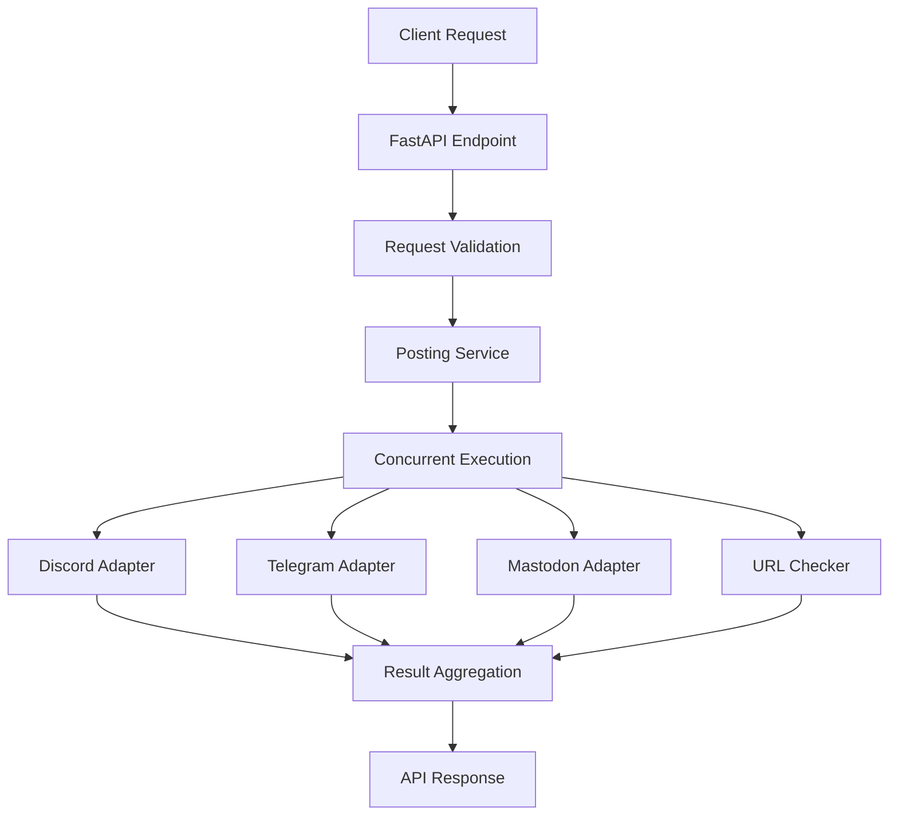
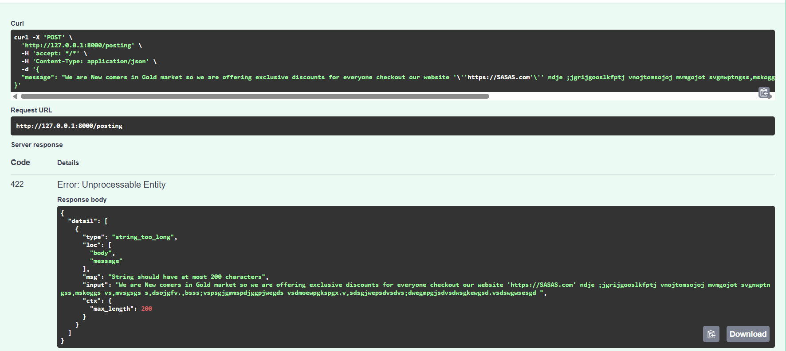
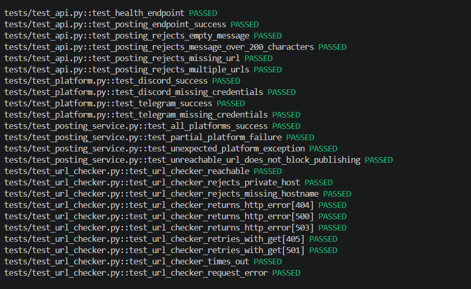
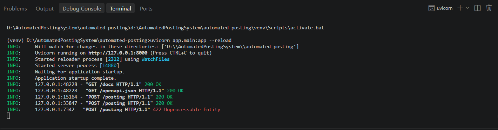

# Automated Multi-Platform Posting System

A lightweight asynchronous posting service built with **Python and FastAPI** that allows you to publish a single message across multiple social platforms through one REST API endpoint.

Currently supports **Discord, Telegram and Mastodon**.

##  Features

- **Single API Endpoint:** Publish content across multiple platforms using one HTTP request.
- **Concurrent Publishing:** Uses Python asynchronous programming to publish to multiple platforms concurrently.
- **Platform Isolation:** A failure on one platform does not prevent publishing to other platforms.
- **URL Validation:** Validates that messages contain exactly one HTTP/HTTPS CTA URL.
- **URL Availability Check:** Checks CTA URL availability and returns warnings without unnecessarily blocking publishing.
- **Platform-Specific Results:** Returns individual publishing status, errors and post URLs.
- **Environment-Based Configuration:** Keeps platform credentials outside the application source code.
- **Extensible Architecture:** Uses the Adapter Pattern to make additional platform integrations easier.

## 🛠️ Technology Stack

| Category | Technology |
|---|---|
| Language | Python 3.10 |
| API Framework | FastAPI |
| HTTP Client | HTTPX |
| Data Validation | Pydantic |
| Configuration | Pydantic Settings |
| Testing | Pytest, pytest-asyncio |
| Server | Uvicorn |
| Architecture | Adapter Pattern, Asynchronous Programming |

##  Supported Platforms

| Platform | Integration | Post URL |
|---|---|---|
| Discord | Webhook API | Available when sufficient message details are returned |
| Telegram | Telegram Bot API | Dynamically generated for public channels |
| Mastodon | Mastodon REST API | Extracted directly from API response |

## Architecture

The application follows an adapter-based architecture. Each platform implements a common interface, allowing the posting service to communicate with different platform APIs without depending on their individual implementation details.

### Request lifecycle



### Design Principles

**1. Adapter Pattern**

Every platform implements the shared `BasePlatform` interface. Platform-specific API communication is encapsulated inside individual adapters.

**2. Asynchronous Execution**

The posting service uses asynchronous execution to initiate publishing operations concurrently instead of waiting for each platform to finish sequentially.

**3. Failure Isolation**

Each platform produces its own result. An individual integration failure does not prevent other platforms from completing their publishing operations.

**4. Separation of Concerns**

- `platforms/`: Platform-specific API integrations.
- `services/`: Publishing orchestration and URL checking.
- `schemas/`: Request and response models.
- `core/`: Application configuration.
- `utils/`: Shared utility functions.

## 📁 Project Structure

```text
automated-posting/
│
├── app/
│   ├── core/
│   │   └── config.py
│   │
│   ├── platforms/
│   │   ├── base.py
│   │   ├── discord.py
│   │   ├── telegram.py
│   │   └── mastodon.py
│   │
│   ├── schemas/
│   │   ├── request.py
│   │   └── response.py
│   │
│   ├── services/
│   │   ├── posting_service.py
│   │   ├── result_service.py
│   │   └── url_checker.py
│   │
│   ├── utils/
│   │   ├── datetime_utils.py
│   │   └── url_validator.py
│   │
│   └── main.py
│
├── tests/
│   ├── conftest.py
│   ├── test_api.py
│   ├── test_platform.py
│   ├── test_posting_service.py
│   ├── test_url_checker.py
│   ├── live_mastodon_check.py
│   └── test_live_platforms.py
│
├── .env.example
├── .gitignore
├── pytest.ini
├── requirements.txt
└── README.md
```

## ⚙️ Installation and Setup

### Prerequisites

- Python 3.10 or later
- Git
- Accounts and API credentials for the platforms you want to use

### 1. Clone the repository

```bash
git clone https://github.com/YOUR_USERNAME/YOUR_REPOSITORY.git
cd YOUR_REPOSITORY
```

### 2. Create a virtual environment

**Windows:**

```powershell
python -m venv venv
venv\Scripts\activate
```

**Linux / macOS:**

```bash
python3 -m venv venv
source venv/bin/activate
```

### 3. Install dependencies

```bash
pip install -r requirements.txt
```

### 4. Configure environment variables

Create a `.env` file in the project root using `.env.example` as a reference.

```env
# Discord
DISCORD_WEBHOOK_URL=
DISCORD_GUILD_ID=

# Telegram
TELEGRAM_BOT_TOKEN=
TELEGRAM_CHAT_ID=

# Mastodon
MASTODON_INSTANCE_URL=
MASTODON_ACCESS_TOKEN=
```

**Credential setup:**

- **Discord:** Create a webhook in your Discord channel settings.
- **Telegram:** Create a bot using BotFather, add it as an administrator to your public channel and configure the channel username.
- **Mastodon:** Register an application in your Mastodon account settings and generate an access token with status-writing permission.

Never commit your `.env` file or expose your API tokens.

### 5. Start the application

```bash
uvicorn app.main:app --reload
```

The application will be available at:

```text
http://localhost:8000
```

Interactive API documentation:

```text
http://localhost:8000/docs
```

## 📡 API Usage

### Health Check

**Endpoint:**

```http
GET /health
```

Checks whether the application is running.

### Publish a Message

**Endpoint:**

```http
POST /posting
```

**Request Body:**

```json
{
  "message": "Check out our latest update: https://example.com"
}
```

**Validation Rules:**

- Message must not exceed 200 characters.
- Message must contain exactly one CTA URL.
- Only HTTP and HTTPS URLs are accepted.

### Example Response

```json
{
  "success": true,
  "url_check": {
    "url": "https://example.com",
    "status": "reachable",
    "warning": null
  },
  "results": [
    {
      "platform": "discord",
      "status": "success",
      "posted_url": null,
      "public_access": null,
      "posted_at": "2026-11-18T12:00:00Z",
      "error": null
    },
    {
      "platform": "telegram",
      "status": "success",
      "posted_url": "https://t.me/channel/123",
      "public_access": null,
      "posted_at": "2026-11-18T12:00:00Z",
      "error": null
    },
    {
      "platform": "mastodon",
      "status": "success",
      "posted_url": "https://mastodon.social/@user/123",
      "public_access": null,
      "posted_at": "2026-11-18T12:00:00Z",
      "error": null
    }
  ],
  "completed_at": "2026-11-18T12:00:01Z"
}
```

*The response above is illustrative. Actual post URLs and timestamps are supplied by the platform integrations. A `null` post URL means a reliable permalink was not available.*

### Example API Response

> The actual response is available in [`ResultScreenshots/response_1795000536479.json`](ResultScreenshots/response_1795000536479.json).

## 🧪 Testing

The project uses Pytest for automated testing.

Run the complete test suite:

```bash
pytest -v
```

Run tests with concise output:

```bash
pytest -q
```

### Test Coverage Areas

- API endpoint behavior and request validation.
- Platform adapter behavior.
- Posting service execution and failure isolation.
- URL validation and availability checking.
- Shared fixtures and mocked platform responses.

Live integration checks are also available in the `tests/` directory. These can publish real messages, so run them deliberately and only with configured credentials.

## ✅ Results

### Automated test results

| Test area | Result |
|---|---:|
| API endpoints | Passed |
| Platform integrations | Passed |
| Posting service | Passed |
| URL checker | Passed |
| Total tests | **32 passed** |
| Warnings | 1 deprecation warning |
| Execution time | 0.68 seconds |

Run all tests with detailed terminal output:

```bash
pytest -v -s
```

### API results

| Scenario | HTTP status | Result |
|---|---:|---|
| Health check | 200 | Passed |
| Valid posting request | 200 | Published successfully |
| Message over 200 characters | 422 | Correctly rejected |
| Missing URL | 422 | Correctly rejected |
| Multiple URLs | 422 | Correctly rejected |

### Actual API response

The latest actual API response is available here:

[View actual response JSON](ResultScreenshots/response_1795000536479.json)

The `ResultScreenshots` folder contains the captured API and platform results:

- Discord posting result
- Telegram posting result
- Mastodon posting result
- Successful API response
- Validation error response

### Result screenshots








## 🔌 Extensibility

The application uses a common platform interface.

To add another platform:

1. Create a new adapter inside `app/platforms/`.
2. Implement the `BasePlatform` interface.
3. Implement the platform-specific authentication and publishing logic.
4. Return a standardized `PlatformResult`.
5. Register the adapter in the application initialization.

This allows new integrations without changing the core posting orchestration.

## 🔮 Future Improvements

Potential improvements for future versions:

- Support for additional social platforms.
- Persistent posting history.
- Background job processing for large publishing workloads.
- Retry mechanisms with duplicate-post protection.
- Rate-limit handling and platform-specific throttling.
- Improved monitoring and observability.
- Deployment using Docker.

---

**Built with Python, FastAPI and asynchronous programming.**